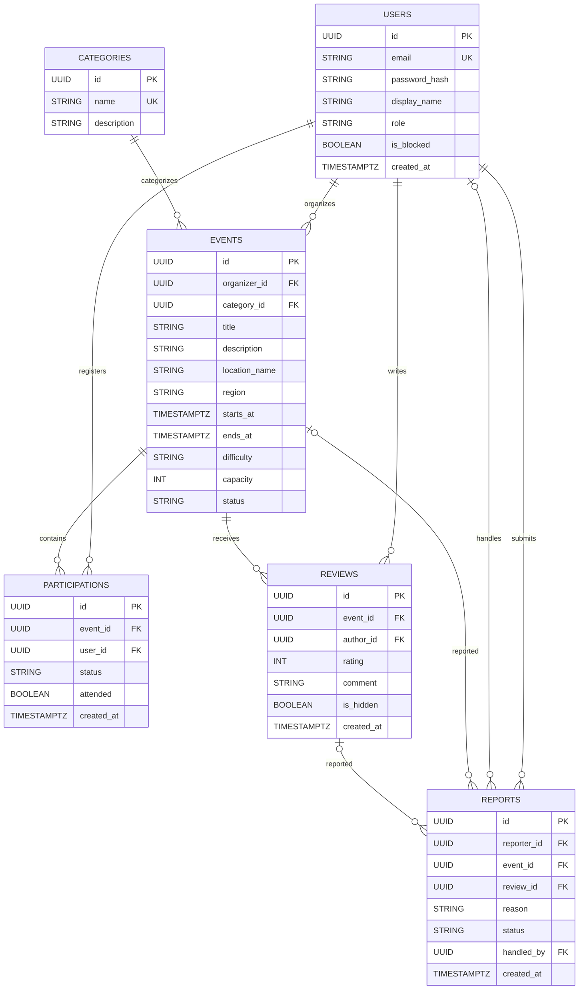

# 03 Podatkovni model
Jan Milošič
## Opis
Podatkovni model aplikacije Joinly temelji na relacijski podatkovni bazi CockroachDB. Entitete so med seboj povezane s primarnimi in tujimi ključi, kar omogoča povezovanje uporabnikov z dogodki, spremljanje prijav ter ocenjevanje in moderiranje vsebin. 

*Podatkovni model je za zdaj le osnova in se lako tekom razvoja spremeni

**Glavne entitete:**
- users: uporabniki in njihove vloge. 
- categories: kategorije dogodkov.
-  events: dogodki in njihove podrobnosti.
-  participations: prijave uporabnikov na dogodke.
-  reviews: ocene in komentarji.
-  reports: prijave neprimernih vsebin.
## Vizualizacija:
