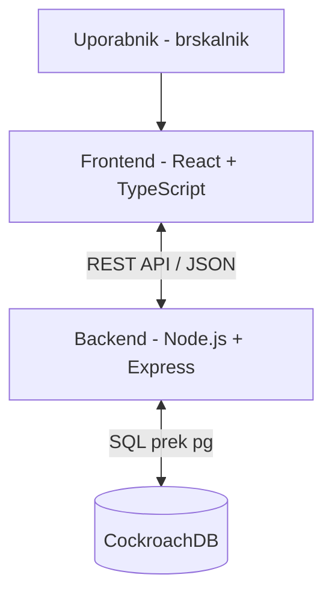

# 04 Arhitektura in tehnoloski sklad
Jan Milošič
## Arhitektura
Aplikacija bo zasnovana kot spletna aplikacija z ločenim frontendom in backendom. Frontend bo skrbel za prikaz dogodkov in uporabniški vmesnik, backend pa za poslovno logiko, avtentikacijo, preverjanje pravic in komunikacijo s podatkovno bazo. Podatki bodo shranjeni v relacijski podatkovni bazi CockroachDB.

**Komunukacija med deli sistema:**
Frontend in backend bosta komunicirala prek REST API, podatki pa se bodo prenašali v formatu JSON. Backend bo za izvajanje SQL poizvedb in povezavo s CockroachDB uporabljal knjižnico pg. Podatkovna baza bo skrbela za trajno shranjevanje uporabnikov, dogodkov, prijav, ocen in drugih podatkov aplikacije.

**Podatkovna baza:**
Za shranjevanje podatkov bo uporabljena CockroachDB, relacijska podatkovna baza, združljiva s PostgreSQL. Podatkovni model bo vseboval povezane entitete, kot so uporabniki, dogodki, kategorije, prijave, ocene in prijave neprimernih vsebin. Za upravljanje baze, pregled tabel in izvajanje SQL poizvedb bom uporabljal DataGrip.

**Avtentikacija:**
Uporabniki se bodo registrirali in prijavljali z e-poštnim naslovom ter geslom. Po uspešni prijavi bo backend izdal žeton JWT, ki bo shranjen v piškotku httpOnly. Backend bo preverjal identiteto uporabnika in njegove pravice. Sistem bo razlikoval med običajnimi uporabniki in moderatorji, pravice organizatorjev pa bo določal glede na lastništvo posameznega dogodka. Gesla bodo ustrezno zaščitena.

**Lokalni razvoj:**
Za lokalni razvoj bo uporabljen Docker Compose, ki bo omogočal zagon podatkovne baze in drugih potrebnih storitev. Nastavitve povezave s podatkovno bazo in skrivnosti bodo shranjene v datoteki .env. Baza bo pripravljena z SQL datotekami, ki bodo shranjene v repozitoriju projekta, kar bo omogočalo ponovljivo vzpostavitev podatkovne sheme na različnih računalnikih.

**Diagram:**

## Tehnološki sklad
Frontend: React, TypeScript, Vite, React Router 
Backend: Node.js, Express, TypeScript 
Podatkovna baza: CockroachDB 
Dostop do baze: DataGrip, pg
Avtentikacija: JWT, httpOnly 
Lokalni razvoj: Docker, Docker Compose
Dodatna orodja: Postman, Recharts, uiverse

## Arhitekturne odločitve
Za izbrani tehnološki sklad sem se odločil, ker gre za tehnologije, ki so še vedno široko uporabljene pri razvoju sodobnih spletnih aplikacij in jih že od prej poznam. CockroachDB sem izbral, ker jo obravnavamo tudi pri drugem predmetu na faksu. React in TypeScript omogočata razvoj uporabniškega vmesnika, Node.js in Express pa ločeno izvajanje poslovne logike na backendu. Za povezavo z bazo bom uporabljal knjižnico pg. Docker Compose bo omogočal enostavnejši in ponovljiv lokalni zagon celotne aplikacije.